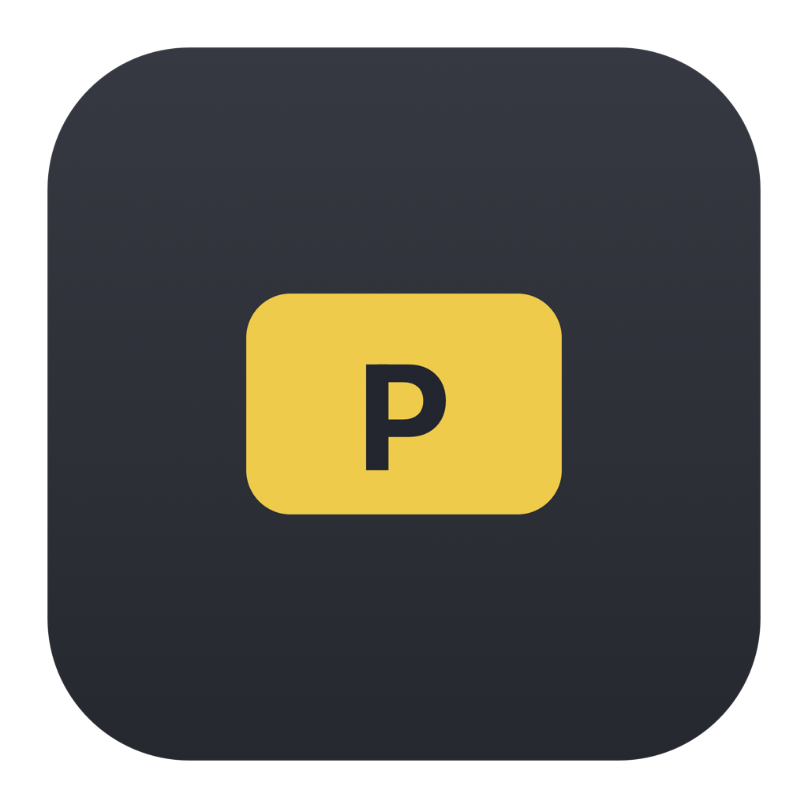
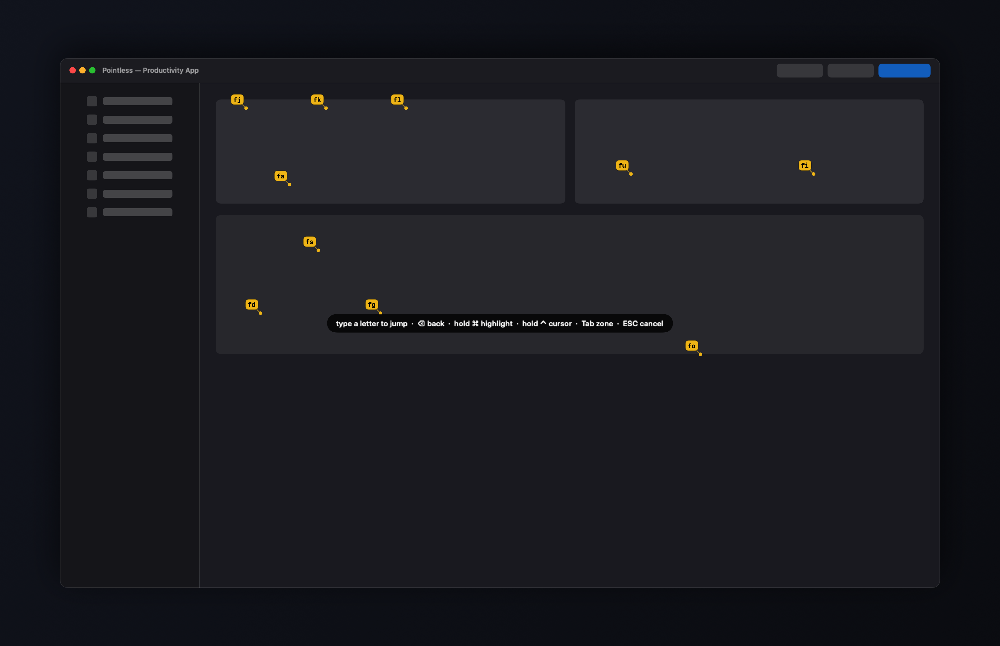

# Pointless

<p align="center">
  
</p>

<h3 align="center">Cursor-Free macOS Navigation</h3>

<p align="center">
  Keyboard-driven navigation for macOS.
</p>

<p align="center">
  
  
  
  
</p>

---

## Overview

**Pointless** is a native macOS application designed for rapid, keyboard-driven navigation. The name reflects its philosophy: *pointer-less*. 

Instead of reaching for a mouse or trackpad, Pointless lets you operate any macOS interface entirely through targeted keyboard commands.

It operates in three modes:
1. **Label Mode**: Scans accessibility trees and places lettered badges near interactive controls.
2. **Zone Mode**: Subdivides the screen into a recursive 3×3 grid for surfaces that lack accessibility trees (e.g. web canvases, video players, games, remote desktops).
3. **Scroll Mode**: Identifies scrollable areas and scrolls via `j`/`k` or `d`/`u`.

Pointless is built in pure Swift using native AppKit, SwiftUI, CoreGraphics event taps, and the macOS Accessibility (`AXUIElement`) APIs.

---

## Visual Tour

### 1. Label Mode
Press <kbd>⌘</kbd><kbd>⇧</kbd><kbd>Space</kbd> to scan the screen and overlay letter badges on clickable controls.

<p align="center">
  
</p>

### 2. Zone Mode
Press <kbd>Tab</kbd> during navigation to switch into Zone Mode. Pointless overlays a 3×3 grid with lookahead hints showing the next sub-regions.

<p align="center">
  
</p>

### 3. Final Zoom Level
On the final zoom level, Zone Mode displays badges outside the grid perimeter connected to cell anchor dots, keeping all click targets uncovered.

<p align="center">
  
</p>

### 4. Settings
Configure shortcuts, grid layout, zoom depth, colors, and menu bar widgets in Settings.

<p align="center">
  
</p>

---

## Features

### Label Mode
- **Accessibility tree discovery**: Searches for buttons, links, inputs, and controls, with fallbacks for browser-specific trees (e.g. Safari hit-testing, Firefox content roots).
- **Badge placement**: Evaluates up to 8 offset positions around each anchor point to reduce overlap and keep controls visible.
- **Adaptive label lengths**: Assigns single-character labels when target count is low (≤ 27), scaling to 2 or 3 characters as target count grows. An optional setting derives hints from control text.
- **Interaction & Modifiers**:
  - Typing a label clicks the control immediately (prefers AX action, falls back to synthetic click; no Enter required).
  - Hold <kbd>⌃</kbd> while typing to move the cursor to the target without clicking.
  - <kbd>⌃</kbd><kbd>Tab</kbd> sets up drag-and-drop from the cursor to a target label.
  - Hold <kbd>⌘</kbd> to inspect element titles and roles.
  - Press <kbd>Esc</kbd> to cancel at any time.

### Zone Mode
- **Coordinate targeting**: Operates on screen coordinates, useful where accessibility trees are missing (e.g. web canvases, games, remote desktop).
- **3×3 subdivision**: Narrows down to a target with key clusters (Right-hand default: `u i o` / `j k l` / `m , .`, Left-hand, or Home row).
- **Lookahead hints**: Shows next-step keys for nested sub-regions. Rapid typing zooms directly without waiting for animations.
- **Actions**:
  - <kbd>Space</kbd>: Left-click center of current zone.
  - <kbd>Return</kbd>: Right-click center of current zone.
  - <kbd>Backspace</kbd>: Step back up one zoom level.
  - <kbd>Tab</kbd>: Switch back to Label Mode.

### Scroll Mode
- **Scroll area targeting**: <kbd>⌘</kbd><kbd>⇧</kbd><kbd>J</kbd> / <kbd>⌘</kbd><kbd>⇧</kbd><kbd>K</kbd> finds and cycles active scroll panes.
- **Keyboard scrolling**:
  - <kbd>j</kbd> / <kbd>↓</kbd>: Scroll down.
  - <kbd>k</kbd> / <kbd>↑</kbd>: Scroll up.
  - <kbd>d</kbd> / <kbd>u</kbd>: Half-page down / up.
- Configurable scroll multiplier (0.25× to 4.0×).

### Optional Plugins
- Optional monitoring widgets ship disabled by default.
- Built-in CPU monitor widget for the menu bar.
- Background timers pause during display sleep.
- Supports external plugin bundles in `~/Library/Application Support/Pointless/Plugins/`.

---

## Keyboard Shortcuts

### General Navigation
| Shortcut | Action |
| :--- | :--- |
| <kbd>⌘</kbd><kbd>⇧</kbd><kbd>Space</kbd> | Activate Label Mode (customizable in Settings) |
| <kbd>Tab</kbd> | Toggle between Label Mode and Zone Mode |
| <kbd>Esc</kbd> | Dismiss current navigation session |
| <kbd>Backspace</kbd> | Clear typed filter / zoom out one level |
| <kbd>⌘</kbd> *(Hold)* | Reveal full accessibility element titles |

### Label Mode Modifiers
| Shortcut | Action |
| :--- | :--- |
| *[Type Hint]* | Left-click target (prefers `AXPress`, falls back to synthetic click) |
| <kbd>⌃</kbd> + *[Type Hint]* | Warp mouse cursor to target without clicking |
| <kbd>⌃</kbd><kbd>Tab</kbd> → *[Type Hint]* | Arm drag at current cursor, drag and drop at target |
| <kbd>⌃</kbd><kbd>Space</kbd> | Left-click at current cursor position |
| <kbd>⌃</kbd><kbd>Return</kbd> | Right-click at current cursor position |

### Zone Mode Controls
| Shortcut | Action |
| :--- | :--- |
| `u i o` / `j k l` / `m , .` | Drill down into 3×3 sub-quadrant (Right Hand default) |
| <kbd>Space</kbd> | Left-click center of current zone immediately |
| <kbd>Return</kbd> | Right-click center of current zone immediately |
| <kbd>Backspace</kbd> | Step back up one zoom level |

### Scroll Mode Controls
| Shortcut | Action |
| :--- | :--- |
| <kbd>⌘</kbd><kbd>⇧</kbd><kbd>J</kbd> | Activate Scroll Mode / Cycle to next scroll pane |
| <kbd>⌘</kbd><kbd>⇧</kbd><kbd>K</kbd> | Cycle to previous scroll pane |
| <kbd>j</kbd> / <kbd>↓</kbd> | Scroll down by line |
| <kbd>k</kbd> / <kbd>↑</kbd> | Scroll up by line |
| <kbd>d</kbd> | Scroll down half page |
| <kbd>u</kbd> | Scroll up half page |

---

## Requirements & Permissions

- **Operating System**: macOS 15.0 (Sequoia) or newer.
- **Permissions**:
  1. **Accessibility (`AXUIElement`)**: Required to inspect window hierarchies, locate interactive controls, and dispatch actions.
  2. **Input Monitoring (`CGEventTap`)**: Required to intercept keyboard input during an active navigation session without stealing window focus.

Pointless includes a built-in onboarding window that verifies permission status and provides one-click shortcuts to System Settings.

---

## Installation

### Download Disk Image (.dmg)

1. Download the latest **`Pointless.dmg`** from [Releases](https://github.com/alterlife/pointless/releases).
2. Open the disk image and drag **Pointless** into your **Applications** folder.
3. On macOS 15+, ad-hoc signed releases require clearing the download quarantine attribute. Either:
   - Run in Terminal:
     ```bash
     xattr -cr /Applications/Pointless.app
     ```
   - Or open **System Settings > Privacy & Security**, scroll to **Security**, and click **Open Anyway**.
4. On first launch, follow the onboarding prompt to grant **Accessibility** permission in System Settings.

*(Homebrew Cask support is coming soon).*

---

## Build & Installation

### Build from Source

```bash
# Clone repository
git clone https://github.com/alterlife/pointless.git
cd pointless

# Build release binary
swift build -c release

# Package into macOS .app bundle
./Scripts/make-app.sh
```

The resulting `Pointless.app` bundle will be created in `build/Pointless.app`. Move it to `/Applications` to run.

### Running Tests and Linting

```bash
# Run the complete XCTest test suite
swift test --parallel

# Run standalone lightweight test runner
swift Tests/run-tests.swift

# Run SwiftLint (strict zero-violation policy)
swiftlint
```

---

## Documentation

- [Zone Mode Deep Dive](docs/ZONE_MODE.md): Detailed guide on the spatial grid, typeahead bursting, lookahead mechanics, and labelled points.
- [Architecture Guide](docs/ARCHITECTURE.md): Comprehensive breakdown of the AX pipeline, discovery passes, rendering engine, and plugin lifecycle.
- [Release Process](docs/RELEASE.md): Step-by-step guide for publishing automated GitHub releases.
- [Packaging Design](docs/DESIGN_PACKAGING.md): Technical specification for bundle creation, ad-hoc signing, and DMG installer.
- [Improvement Plan](IMPROVEMENTS.md): Future roadmap for label stability, diagnostics, and performance.

---

## License

Pointless is open-source software licensed under the [MIT License](LICENSE).
