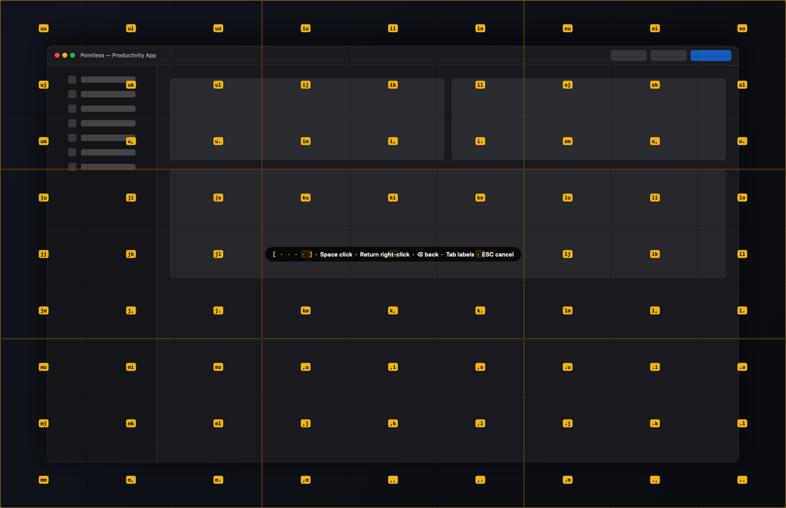
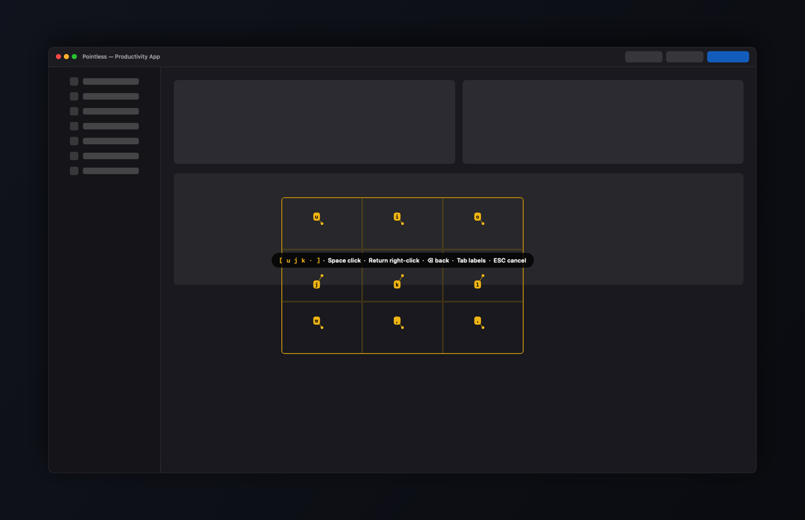
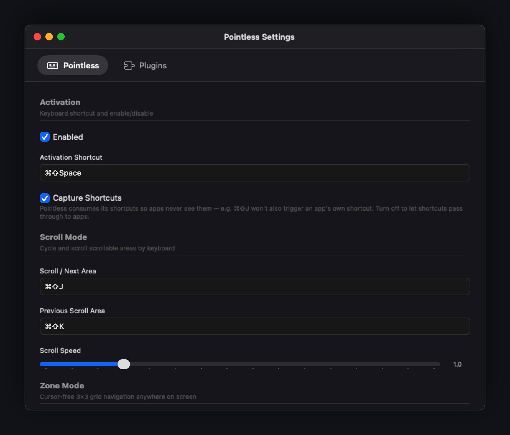

# Pointless

<p align="center">
  
</p>

<h3 align="center">Cursor-Free macOS Navigation</h3>

<p align="center">
  Navigate, click, scroll, and zoom across any macOS application without touching a mouse or trackpad.
</p>

<p align="center">
  
  
  
  
</p>

---

## Overview

**Pointless** is a native macOS application designed for rapid, keyboard-driven navigation. The name reflects its philosophy: *pointer-less*. 

Instead of reaching for a mouse or trackpad, Pointless lets you operate any macOS interface entirely through targeted keyboard commands.

It operates in three modes:
1. **Label Mode (Element Navigation)**: Scans active accessibility trees and generates clean, non-overlapping two-letter badges over every interactive control.
2. **Zone Mode (Spatial Grid & Lookahead Zoom)**: Subdivides the display into a recursive 3×3 grid with two-letter lookahead discoverability, typeahead chording, and unobscured click targeting.
3. **Scroll Mode**: Outlines scrollable content areas and drives smooth, momentum-buffered vertical scrolling via `j`/`k` and `d`/`u`.

Pointless is built in pure Swift using native AppKit, SwiftUI, CoreGraphics event taps, and the macOS Accessibility (`AXUIElement`) APIs.

---

## Visual Tour

### 1. Label Mode — Native Control Targeting
Press <kbd>⌘</kbd><kbd>⇧</kbd><kbd>Space</kbd> to analyze the screen and generate collision-free target badges linked to clickable controls with anchor dots and connector lines.

<p align="center">
  
</p>

### 2. Zone Mode — 3×3 Spatial Grid with 2-Letter Lookahead
Press <kbd>Tab</kbd> during navigation to switch into Zone Mode. Pointless overlays a 3×3 spatial grid where each quadrant displays nested two-letter lookahead hints showing exactly where your next keypress leads.

<p align="center">
  
</p>

### 3. Final Zoom Level — Uncovered Click Targets
On the final zoom level, Zone Mode automatically converts from bounding boxes to offset badges and anchor dots using the canonical badge placement engine. Your target click surface is never obscured by badges.

<p align="center">
  
</p>

### 4. Comprehensive Settings
Configure activation shortcuts, grid key clusters, zoom depth, label coloring, and status widgets directly from the native macOS Settings window.

<p align="center">
  
</p>

---

## Features

### 🎯 Label Mode (Interactive Elements)
- **Deep Accessibility Tree Traversal**: Multi-pass discovery scans standard buttons, links, inputs, popups, and tab bars.
- **App-Specific Fallbacks**: Custom passes handle complex web areas (Safari Start Page hit-testing) and broken window hierarchies (Firefox content roots).
- **Collision-Free Badge Placement**: Evaluates eight candidate placement offsets around anchor points to avoid obscuring controls and colliding with neighboring badges.
- **Smart Label Generation**:
  - Automatically provisions single-character labels when target counts are low.
  - Generates prefix-safe uniform two-letter hints for dense screens.
  - Option to derive mnemonics directly from control text (e.g., "Save" → `s`).
- **Cursor Warping & Context Modifiers**:
  - Hold <kbd>⌃</kbd> while typing a hint to warp the mouse cursor to the element without triggering an immediate click.
  - Press <kbd>⌃</kbd><kbd>Tab</kbd> to arm drag mode, then type the destination hint to execute a precision drag-and-drop.
  - Press <kbd>⌃</kbd><kbd>Space</kbd> or <kbd>⌃</kbd><kbd>Return</kbd> for instant left or right click at current cursor coordinates.
  - Hold <kbd>⌘</kbd> to reveal the full underlying element name and role.

### 🌐 Zone Mode (Spatial Grid & Rapid Zoom)
- **Zero-Dependency Navigation**: Works on canvas elements, video players, games, remote desktop viewers, maps, and unexposed AX trees.
- **Ergonomic Key Clusters**:
  - **Right Hand** (*Default*): `u i o` / `j k l` / `m , .`
  - **Left Hand**: `q w e` / `a s d` / `z x c`
  - **Classic Home Row**: `a s d` / `f j k` / `l g h`
- **2-Letter Lookahead Discoverability**: Every cell displays its primary key alongside all nine nested sub-quadrant addresses, removing guesswork.
- **Typeahead Chording**: Burst through hierarchies instantly—type `kk` or `ee` rapidly to jump straight into deep sub-quadrants.
- **Breadcrumb HUD**: Live indicator (`[ k · · · ]` → `[ k k · · ]`) visualizes your navigation depth.
- **Labelled Point Landing**: Automatically converts from cell borders to offset badges and anchor dots on the deepest level so you can see exactly what you are clicking.
- **Instant Actions**:
  - Press <kbd>Space</kbd> to left-click the center of the current zone immediately.
  - Press <kbd>Return</kbd> to right-click the center of the current zone immediately.
  - Press <kbd>Backspace</kbd> to zoom out one level.
  - Press <kbd>Tab</kbd> to toggle back to Label Mode at any time.

### 📜 Scroll Mode
- **Automatic Scroll Target Discovery**: Press <kbd>⌘</kbd><kbd>⇧</kbd><kbd>J</kbd> or <kbd>⌘</kbd><kbd>⇧</kbd><kbd>K</kbd> to identify active scroll panes and cycle between them.
- **Buffered Inertial Scrolling**:
  - <kbd>j</kbd> or <kbd>↓</kbd>: Scroll down.
  - <kbd>k</kbd> or <kbd>↑</kbd>: Scroll up.
  - <kbd>d</kbd>: Half-page jump down.
  - <kbd>u</kbd>: Half-page jump up.
- **Momentum Drain Timer**: Queued distance drains smoothly across 120Hz display refresh cycles to avoid jerky stepped scrolling.
- **Configurable Scroll Speed**: Fine-tune scroll multiplier from 0.25× to 4.0×.

### 🔌 Extensible Plugin Architecture
- **Non-Intrusive**: Optional monitoring widgets ship disabled by default so the core application stays focused on navigation.
- **Built-in CPU Monitor**: Real-time multi-core usage graphs and menu bar readouts.
- **Lifecycle Automation**: Background timers automatically suspend on display sleep and resume upon wake.
- **External Bundle Support**: Load third-party plugins dynamically from `~/Library/Application Support/Pointless/Plugins/`.

---

## Keyboard Shortcuts

### General Navigation
| Shortcut | Action |
| :--- | :--- |
| <kbd>⌘</kbd><kbd>⇧</kbd><kbd>Space</kbd> | Activate Label Mode (customizable in Settings) |
| <kbd>Tab</kbd> | Toggle between Label Mode and Zone Mode |
| <kbd>Esc</kbd> | Dismiss current navigation session |
| <kbd>Backspace</kbd> | Clear typed filter / zoom out one level |
| <kbd>⌘</kbd> *(Hold)* | Reveal full accessibility element titles |

### Label Mode Modifiers
| Shortcut | Action |
| :--- | :--- |
| *[Type Hint]* | Left-click target (prefers `AXPress`, falls back to synthetic click) |
| <kbd>⌃</kbd> + *[Type Hint]* | Warp mouse cursor to target without clicking |
| <kbd>⌃</kbd><kbd>Tab</kbd> → *[Type Hint]* | Arm drag at current cursor, drag and drop at target |
| <kbd>⌃</kbd><kbd>Space</kbd> | Left-click at current cursor position |
| <kbd>⌃</kbd><kbd>Return</kbd> | Right-click at current cursor position |

### Zone Mode Controls
| Shortcut | Action |
| :--- | :--- |
| `u i o` / `j k l` / `m , .` | Drill down into 3×3 sub-quadrant (Right Hand default) |
| <kbd>Space</kbd> | Left-click center of current zone immediately |
| <kbd>Return</kbd> | Right-click center of current zone immediately |
| <kbd>Backspace</kbd> | Step back up one zoom level |

### Scroll Mode Controls
| Shortcut | Action |
| :--- | :--- |
| <kbd>⌘</kbd><kbd>⇧</kbd><kbd>J</kbd> | Activate Scroll Mode / Cycle to next scroll pane |
| <kbd>⌘</kbd><kbd>⇧</kbd><kbd>K</kbd> | Cycle to previous scroll pane |
| <kbd>j</kbd> / <kbd>↓</kbd> | Scroll down by line |
| <kbd>k</kbd> / <kbd>↑</kbd> | Scroll up by line |
| <kbd>d</kbd> | Scroll down half page |
| <kbd>u</kbd> | Scroll up half page |

---

## Requirements & Permissions

- **Operating System**: macOS 15.0 (Sequoia) or newer.
- **Permissions**:
  1. **Accessibility (`AXUIElement`)**: Required to inspect window hierarchies, locate interactive controls, and dispatch actions.
  2. **Input Monitoring (`CGEventTap`)**: Required to intercept keyboard input during an active navigation session without stealing window focus.

Pointless includes a built-in onboarding window that verifies permission status and provides one-click shortcuts to System Settings.

---

## Build & Installation

### Build from Source

```bash
# Clone repository
git clone https://github.com/alterlife/pointless.git
cd pointless

# Build release binary
swift build -c release

# Package into macOS .app bundle
./Scripts/make-app.sh
```

The resulting `Pointless.app` bundle will be created in `build/Pointless.app`. Move it to `/Applications` to run.

### Running Tests and Linting

```bash
# Run the complete XCTest test suite
swift test --parallel

# Run standalone lightweight test runner
swift Tests/run-tests.swift

# Run SwiftLint (strict zero-violation policy)
swiftlint
```

---

## Documentation

- [Zone Mode Deep Dive](docs/ZONE_MODE.md): Detailed guide on the spatial grid, typeahead bursting, lookahead mechanics, and labelled points.
- [Architecture Guide](docs/ARCHITECTURE.md): Comprehensive breakdown of the AX pipeline, discovery passes, rendering engine, and plugin lifecycle.
- [Improvement Plan](IMPROVEMENTS.md): Future roadmap for label stability, diagnostics, and performance.

---

## License

Pointless is open-source software licensed under the [MIT License](LICENSE).
