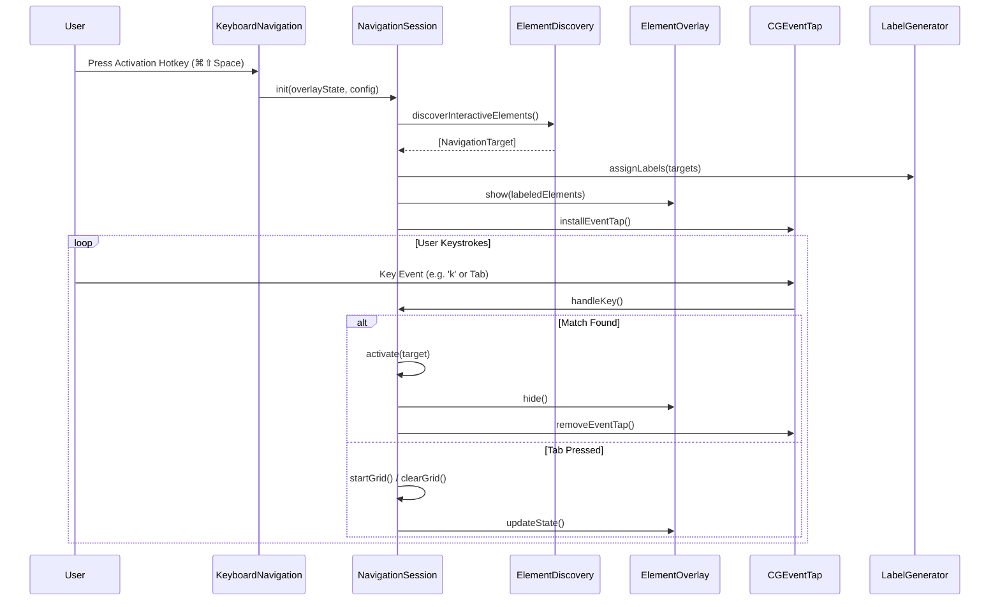
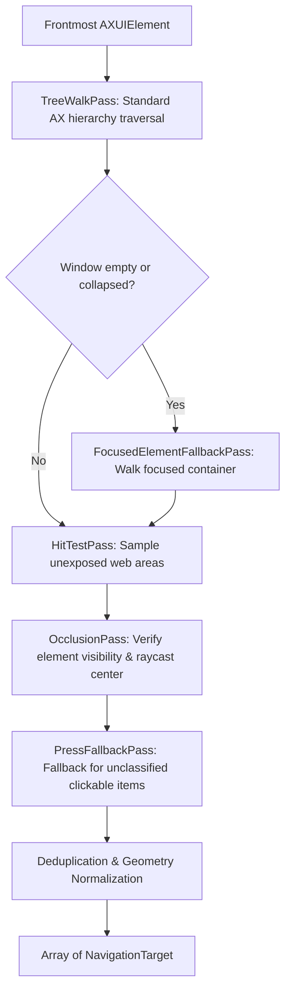

# Pointless Architecture

This document describes the internal design, component responsibilities, and data flow of Pointless.

---

## 1. Design Philosophy

Pointless follows core design rules enforced across the codebase:

1. **Lint-Enforced Code Quality**: SwiftLint is enforced strictly with **0 violations** allowed.
2. **Declarative Over Imperative**: Settings definitions and widget layouts are pure data declarations (`declareSettings([...])`, `menuBarWidgets()`). Hand-wired imperative state synchronization in the application shell is prohibited.
3. **Strict Lifetime Management**: Combine subscriptions are retained in cancellable bags; timers are invalidated on stop or sleep; event monitors and `CGEventTap` ports are disabled and released cleanly upon session termination.
4. **No Raw AX Calls in Business Logic**: All raw `AXUIElement` APIs, CoreFoundation casting workarounds, and attribute queries are strictly encapsulated in `AX/AXElement.swift`.

---

## 2. System Overview

Pointless separates the core product from optional accessories:

```
Sources/Pointless/
├── App/                          # App lifecycle, plugin registry, logging, screen sleep
│   ├── AppDelegate.swift
│   ├── PluginRegistry.swift
│   ├── ScreenStateMonitor.swift
│   └── Logger.swift
├── AX/                           # Low-level accessibility abstraction
│   ├── AXElement.swift           # Typed facade over AXUIElement
│   ├── AXNode.swift
│   └── AXTreeNode.swift
├── Navigation/                   # CORE FEATURE: Cursor-free navigation
│   ├── KeyboardNavigation.swift  # Global hotkeys, settings host, session coordinator
│   ├── NavigationSession.swift   # Single active navigation session lifecycle
│   ├── NavigationSession+Cursor.swift   # Cursor warping, drag, mouse events
│   ├── NavigationSession+Grid.swift     # Zone Mode 3×3 spatial logic
│   ├── NavigationSession+Scrolling.swift# Inertial scrolling state & drain
│   ├── ElementOverlay.swift      # Borderless fullscreen overlay windows
│   ├── ElementOverlay+Grid.swift # Zone Mode grid and lookahead canvas rendering
│   ├── BadgePlacement.swift      # Collision-free badge layout engine
│   ├── LabelGenerator.swift      # Pure prefix-free hint label generation
│   ├── ShortcutParsing.swift     # Hotkey string parsing
│   └── Discovery/                # Multi-pass element discovery pipeline
│       ├── ElementDiscovery.swift
│       ├── DiscoveryPass.swift
│       ├── TreeWalkPass.swift
│       ├── FocusedElementFallbackPass.swift
│       ├── HitTestPass.swift
│       ├── OcclusionPass.swift
│       └── PressFallbackPass.swift
├── Core/                         # Shared protocols and registry
│   ├── SettingsHost.swift
│   ├── Widget.swift
│   ├── WidgetRegistry.swift
│   └── WidgetConfig.swift
├── Plugins/                      # Optional background monitoring plugins
│   ├── Plugin.swift
│   ├── PluginSettings.swift
│   ├── PluginLifecycle.swift
│   └── CPU/
└── UI/                           # SwiftUI & AppKit presentation
    ├── MenuBar.swift
    ├── MenuBarCombinedView.swift
    ├── SettingsView.swift
    ├── SettingsViewHelpers.swift
    ├── SettingsWindowManager.swift
    └── ObservableWidgetView.swift
```

---

## 3. Core Navigation Lifecycle

A navigation session begins when a global hotkey fires (<kbd>⌘</kbd><kbd>⇧</kbd><kbd>Space</kbd> or <kbd>⌘</kbd><kbd>⇧</kbd><kbd>J</kbd>):



### Event Interception via `CGEventTap`
Pointless does not take keyboard focus away from the active application window. Instead, it registers a `CGEventTap` at `.cghidEventTap` with `.headInsertEventTap`. 

This enables:
- Seamless typing without window focus transitions or flashing title bars.
- Immediate consumption of hotkeys so background applications do not misinterpret navigation strokes.
- Clean release and restoration of input streams the moment a session ends.

---

## 4. Accessibility Discovery Pipeline

Interactive elements are gathered through a sequential pipeline of passes orchestrated by `ElementDiscovery.swift`.

New application quirks or framework workarounds are implemented as new `DiscoveryPass` classes rather than modifying existing logic:



### Key Discovery Passes:
1. **`TreeWalkPass`**: Standard recursive descent through windows, toolbars, splitters, tab groups, and buttons.
2. **`FocusedElementFallbackPass`**: When Firefox or certain web apps expose empty top-level windows, this pass inspects the currently focused AX element and ascends to locate content roots.
3. **`HitTestPass`**: For complex web pages (such as the Safari Start Page) where accessibility children are not populated until interacted with, samples points across the viewport using `AXUIElementCopyElementAtPosition`.
4. **`OcclusionPass`**: Eliminates elements that are hidden beneath overlapping sheets, popovers, or offscreen viewports.
5. **`PressFallbackPass`**: Validates whether elements support `kAXPressAction` even if their declared role is generic.

---

## 5. Collision-Free Badge Placement Engine

Once targets are discovered, `BadgePlacement.swift` calculates optimal on-screen badge coordinates:

1. **Anchor Point Selection**: Computes the visual center of the control's bounding box.
2. **8-Candidate Placement Check**:
   Evaluates 8 candidate offsets around the anchor in order of preference:
   - Top-Left, Top-Right, Bottom-Left, Bottom-Right, Top-Center, Bottom-Center, Left-Center, Right-Center.
3. **Overlap Testing**:
   Each candidate position is checked against:
   - The element's own anchor dot.
   - Screen boundaries (with top inset for the macOS notch and menu bar).
   - All previously placed badges.
4. **Connector Line Rendering**:
   When a badge is placed at an offset, a high-contrast line connects the badge to its anchor dot, ensuring unambiguous targeting even in dense layouts.

---

## 6. Zone Mode Engine

Zone Mode provides spatial navigation without requiring accessibility data:

```
[Screen Region: (0, 0, 1728, 1117)]
               │
       ┌───────┼───────┐
       ▼       ▼       ▼
    Row 0   Row 1   Row 2
    (u i o) (j k l) (m , .)
```

- **Data Model**: `NavigationSession` maintains `gridRegions: [CGRect]` and `gridPath: [Character]`.
- **Lookahead Calculation**: At any zoom level below maximum, the renderer calculates the 9 sub-cells for each quadrant and formats 2-letter labels combining the quadrant key and sub-cell key.
- **Labelled Point Conversion**: On the maximum zoom level, the 9 sub-cell centers are passed directly to `placeBadges`, rendering discrete anchor points and offset badges.
- **Click Dispatch**: Upon completion, the screen center of the target cell is translated to CGEvent coordinates, the cursor is warped via `CGWarpMouseCursorPosition`, and a synthetic mouse click is posted.

---

## 7. Plugin System & Settings Architecture

Pointless includes a lightweight, declarative plugin architecture:

```
Plugin Protocol (Plugin.swift)
  ├── id: String
  ├── name: String
  ├── settings() -> PluginSettings
  ├── menuBarWidgets() -> [MenuBarWidget]
  └── menuWidgets() -> [MenuWidget]
```

- **Lifecycle Automation**: `PluginLifecycle.swift` automatically attaches update timers and ties suspension/resumption to system sleep notifications via `ScreenStateMonitor`.
- **Dynamic External Plugins**: `PluginRegistry.loadExternalPlugins()` scans `~/Library/Application Support/Pointless/Plugins/*.bundle` for third-party bundles conforming to the `Plugin` protocol.
- **Unified Settings Host**: Both the core `KeyboardNavigation` controller and monitoring plugins conform to `SettingsHost`, enabling a unified, dark-themed SwiftUI Settings interface (`SettingsView.swift`).
