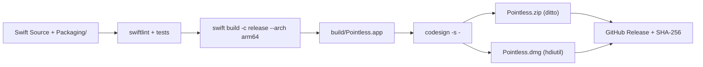

# Pointless — Packaging & Distribution Design

## 1. Problem & Motivation

Pointless currently compiles via `swift build`, but has no automated distribution pipeline to package, sign, and publish binary releases. Users who do not have Xcode or Swift toolchains cannot install the app.

Distributing outside the Mac App Store without a paid Apple Developer ID requires solving three concrete constraints:
1. **Apple Silicon Execution:** macOS on arm64 requires all executable code to be at least ad-hoc signed (`codesign -s -`). Completely unsigned binaries fail to launch.
2. **Gatekeeper Quarantine:** Binaries downloaded via browser receive the `com.apple.quarantine` extended attribute. On macOS 15 Sequoia, Gatekeeper removed the Right-click bypass, requiring either `xattr -cr` or explicit approval under System Settings.
3. **Repeatable Release Builds:** Releases must build in CI, run lint and test verification, output checksummed assets (`.dmg` and `.zip`), and publish automatically when a version tag is pushed.

---

## 2. Deliverables & Artifact Formats



| Artifact | Format | Purpose | Tool |
| :--- | :--- | :--- | :--- |
| **`Pointless.app`** | macOS App Bundle | Target executable with `Info.plist` and icon | `Scripts/make-app.sh` |
| **`Pointless.zip`** | PKZip (`ditto`) | Clean archive preserving resource forks & symlinks | `ditto -c -k` |
| **`Pointless.dmg`** | Compressed Disk Image (UDZO) | Drag-and-drop installer with `/Applications` symlink | `Scripts/make-dmg.sh` (`hdiutil`) |
| **`checksums.txt`** | Plain Text | SHA-256 hashes for verification and Homebrew cask | `shasum -a 256` |

---

## 3. Bundle Structure & Assembly

The bundle is assembled inside `build/Pointless.app`:

```
build/Pointless.app/
├── Contents/
│   ├── Info.plist                # Sourced from Packaging/Info.plist
│   ├── MacOS/
│   │   └── Pointless             # Compiled release binary from $(swift build --show-bin-path)
│   └── Resources/
│       └── Pointless.icns        # Sourced from Packaging/Pointless.icns
```

### Bundle Specifications
- **Executable:** Built with `swift build -c release --arch arm64` (native Apple Silicon). Binary location resolved dynamically via `swift build --show-bin-path`.
- **Bundle ID:** `com.alterlife.pointless` (defined in `Packaging/Info.plist`).
- **Accessory App:** `LSUIElement = true` ensures the app docks in the menu bar without appearing in the Dock.
- **Code Signature:** Ad-hoc signature sealed and verified with:
  ```bash
  codesign --force --deep --sign - "build/Pointless.app"
  codesign --verify --deep --strict "build/Pointless.app"
  ```

---

## 4. Disk Image (`.dmg`) Creation

The disk image is produced by `Scripts/make-dmg.sh` using native macOS tools without third-party dependencies:

1. **Cleanup Trap & Private Mount:**
   - Registers separated `EXIT`, `INT`, and `TERM` signal traps to unmount and remove temporary staging directories cleanly without double execution.
   - Uses a private temporary mountpoint via `mktemp -d /tmp/pointless-mount.XXXXXX`.
2. **Staging Directory:**
   - Copies `build/Pointless.app` into staging via `ditto` preserving macOS bundle flags.
   - Symlinks `/Applications` into staging.
3. **Disk Image Generation:**
   ```bash
   hdiutil create \
     -volname "Pointless" \
     -srcfolder "build/dmg-staging" \
     -ov -format UDZO \
     "build/Pointless.dmg"
   ```
4. **Verification:**
   - Mounts the image via `hdiutil attach -mountpoint "$MOUNT_DIR" -nobrowse -readonly`.
   - Validates that `Pointless.app` and the `/Applications` symlink exist; fails non-zero immediately if missing.
   - Detaches cleanly and generates SHA-256 checksums.

---

## 5. GitHub Actions Release Automation

The workflow file `.github/workflows/release.yml` triggers on semantic tag creation (`v*.*.*`) or explicit manual dispatch:

- **Tags & Branches:** Tags are validated against `^v[0-9]+\.[0-9]+\.[0-9]+$`; manual dispatches are restricted strictly to `main`.
- **Version Propagation:** Passes release version tag to `make-app.sh` which updates `CFBundleShortVersionString` via `plutil`.
- **Verification Gates:** Runs `swiftlint --strict`, `swift Tests/run-tests.swift`, and `swift test` prior to compilation.
- **Full History:** Uses `fetch-depth: 0` so `gh release create --generate-notes` generates accurate changelogs.
- **Artifacts:** Publishes `Pointless.dmg`, `Pointless.zip`, and `checksums.txt`.

---

## 6. End-User Installation Contract

Because the app is distributed ad-hoc signed, user-facing release notes state the installation steps:

### Drag-and-Drop (.dmg)
1. Download `Pointless.dmg` from the latest GitHub Release.
2. Open the DMG and drag **Pointless** into **Applications**.
3. On macOS 15+, ad-hoc signed releases require clearing the download quarantine attribute:
   - Run in Terminal:
     ```bash
     xattr -cr /Applications/Pointless.app
     ```
   - Or open **System Settings > Privacy & Security > Security**, and click **Open Anyway**.
4. On launch, grant **Accessibility** permission in the setup prompt to enable hotkey interception and UI element scanning.

*(Homebrew Cask distribution is planned for a future release).*

---

## 7. Scope & Boundaries

### In Scope
- Hardening `Scripts/make-app.sh` and `Scripts/make-dmg.sh` with verification, error traps, and strict codesigning.
- Automated release workflow in `.github/workflows/release.yml` with test and lint gates.
- Documentation in `README.md`, `docs/RELEASE.md`, and `docs/DESIGN_PACKAGING.md`.

### Out of Scope (Deferred to Developer ID Subscription)
- Apple Developer ID signing certificate (`Developer ID Application: ...`).
- Notarization submission via `xcrun notarytool` and stapling via `xcrun stapler`.
- Sparkle in-app automatic updater framework.
