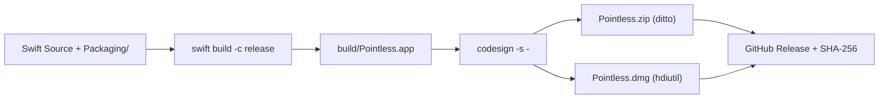

# Pointless — Packaging & Distribution Design

## 1. Problem & Motivation

Pointless currently compiles via `swift build`, but has no automated distribution pipeline to package, sign, and publish binary releases. Users who do not have Xcode or Swift toolchains cannot install the app.

Distributing outside the Mac App Store without a paid Apple Developer ID requires solving three concrete constraints:
1. **Apple Silicon Execution:** macOS on arm64 requires all executable code to be at least ad-hoc signed (`codesign -s -`). Completely unsigned binaries fail to launch.
2. **Gatekeeper Quarantine:** Binaries downloaded via browser receive the `com.apple.quarantine` extended attribute. Without Developer ID notarization, Finder flags the app as damaged or untrusted unless bypassed.
3. **Repeatable Release Builds:** Releases must build in CI, output checksummed assets (`.dmg` and `.zip`), and publish automatically when a version tag is pushed.

---

## 2. Deliverables & Artifact Formats



| Artifact | Format | Purpose | Tool |
| :--- | :--- | :--- | :--- |
| **`Pointless.app`** | macOS App Bundle | Target executable with `Info.plist` and icon | `Scripts/make-app.sh` |
| **`Pointless.zip`** | PKZip (`ditto`) | Clean archive preserving resource forks & symlinks | `ditto -c -k` |
| **`Pointless.dmg`** | Compressed Disk Image (UDZO) | Drag-and-drop installer with `/Applications` symlink | `Scripts/make-dmg.sh` (`hdiutil`) |
| **`checksums.txt`** | Plain Text | SHA-256 hashes for verification and Homebrew cask | `shasum -a 256` |

---

## 3. Bundle Structure & Assembly

The bundle is assembled inside `build/Pointless.app`:

```
build/Pointless.app/
├── Contents/
│   ├── Info.plist                # Sourced from Packaging/Info.plist
│   ├── MacOS/
│   │   └── Pointless             # Compiled release binary (.build/release/Pointless)
│   └── Resources/
│       └── Pointless.icns        # Sourced from Packaging/Pointless.icns
```

### Bundle Specifications
- **Executable:** Built with `swift build -c release --arch arm64` (native Apple Silicon).
- **Bundle ID:** `com.alterlife.pointless` (defined in `Packaging/Info.plist`).
- **Accessory App:** `LSUIElement = true` ensures the app docks in the menu bar without appearing in the Dock.
- **Code Signature:** Ad-hoc signature sealed with:
  ```bash
  codesign --force --deep --sign - "build/Pointless.app"
  ```

---

## 4. Disk Image (`.dmg`) Creation

The disk image is produced by `Scripts/make-dmg.sh` using native macOS tools without third-party dependencies:

1. **Staging Directory:**
   ```
   build/dmg-staging/
   ├── Pointless.app
   └── Applications -> /Applications
   ```
2. **Disk Image Generation:**
   ```bash
   hdiutil create \
     -volname "Pointless" \
     -srcfolder "build/dmg-staging" \
     -ov -format UDZO \
     "build/Pointless.dmg"
   ```
3. **Verification:** Mounts the image temporarily with `hdiutil attach`, verifies bundle integrity and symlink resolution, and detaches.

---

## 5. GitHub Actions Release Automation

A new workflow file `.github/workflows/release.yml` triggers on tag creation:

```yaml
name: Release

on:
  push:
    tags:
      - 'v*.*.*'
  workflow_dispatch:

jobs:
  release:
    name: Build & Publish Release
    runs-on: macos-15
    permissions:
      contents: write
    steps:
      - uses: actions/checkout@v7
      - name: Build Application Bundle
        run: bash Scripts/make-app.sh
      - name: Build Disk Image and Archive
        run: bash Scripts/make-dmg.sh
      - name: Generate Checksums
        run: |
          cd build
          shasum -a 256 Pointless.dmg Pointless.zip > checksums.txt
      - name: Publish GitHub Release
        env:
          GITHUB_TOKEN: ${{ secrets.GITHUB_TOKEN }}
        run: |
          gh release create "${{ github.ref_name }}" \
            build/Pointless.dmg \
            build/Pointless.zip \
            build/checksums.txt \
            --title "Pointless ${{ github.ref_name }}" \
            --generate-notes
```

---

## 6. End-User Installation Contract

Because the app is distributed ad-hoc signed, user-facing release notes must state the installation paths clearly:

### Option A: Homebrew Cask (Recommended — No Quarantine)
```bash
brew tap alterlife/pointless https://github.com/alterlife/pointless
brew install --cask pointless
```
*Homebrew automatically strips `com.apple.quarantine`, allowing immediate execution.*

### Option B: Drag-and-Drop (.dmg)
1. Download `Pointless.dmg` from the latest GitHub Release.
2. Open the DMG and drag **Pointless** into **Applications**.
3. On first launch, if macOS displays *"Pointless cannot be opened because Apple cannot check it for malicious software"*:
   - Either **Right-click Pointless.app → Open → Click Open**, or
   - Run in Terminal:
     ```bash
     xattr -cr /Applications/Pointless.app
     ```
4. On launch, grant **Accessibility** permission in the setup prompt to enable hotkey interception and UI element scanning.

---

## 7. Scope & Boundaries

### In Scope
- Refactoring `Scripts/make-app.sh` for robust release packaging.
- Adding `Scripts/make-dmg.sh` using native `hdiutil`.
- Creating `.github/workflows/release.yml` for automated GitHub releases.
- Generating `checksums.txt` for release assets.

### Out of Scope (Deferred to Developer ID Subscription)
- Apple Developer ID signing certificate (`Developer ID Application: ...`).
- Notarization submission via `xcrun notarytool` and stapling via `xcrun stapler`.
- Sparkle in-app automatic updater framework.
