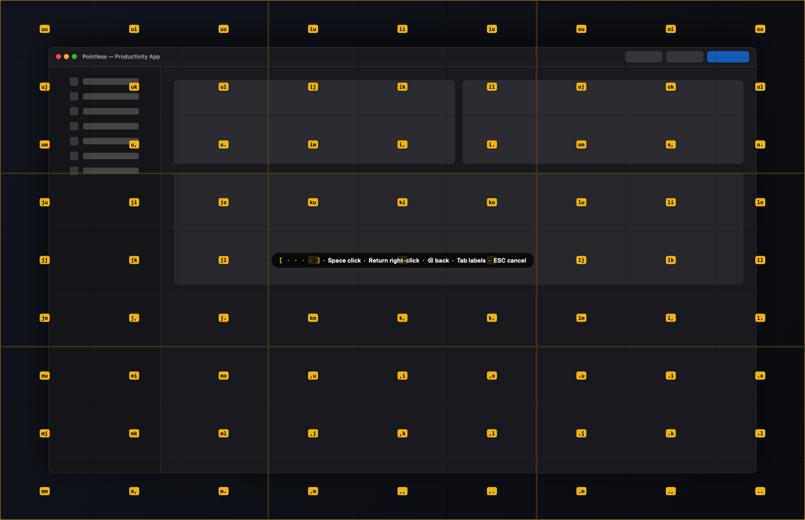
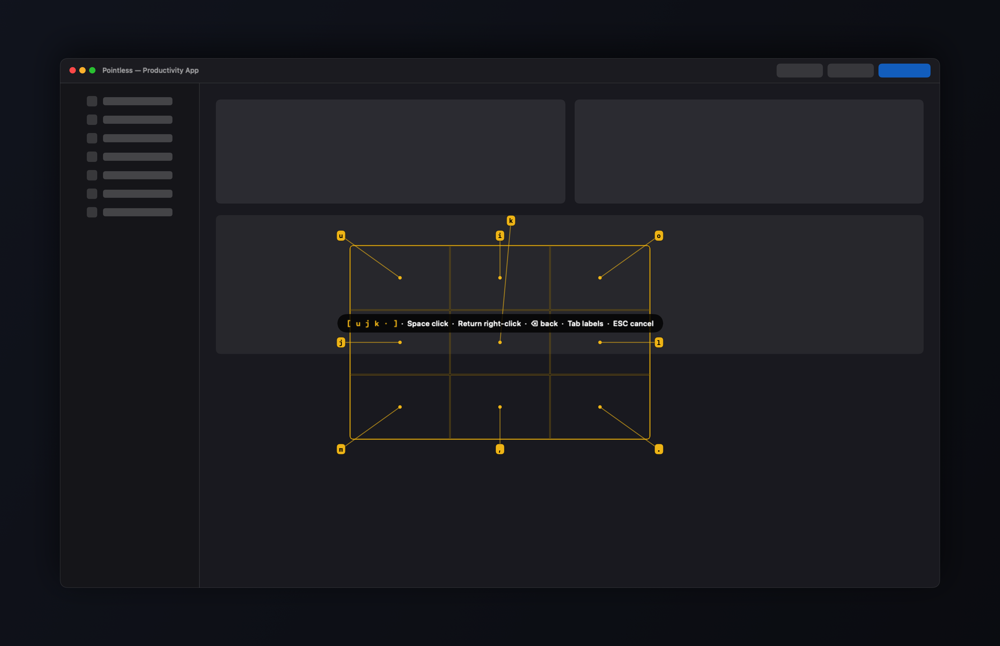

# Zone Mode — Spatial Grid Navigation

<p align="center">
  
</p>

## Introduction

While **Label Mode** works exceptionally well for applications that expose standard macOS Accessibility (`AXUIElement`) trees, modern workflows frequently involve user interfaces where accessibility trees are incomplete, collapsed, or entirely absent:

- Web-based canvases (Figma, Miro, Google Docs canvas renderer, Canva).
- Remote desktops and screen sharing (VNC, Remote Desktop, Citrix, Parallels).
- Maps, GIS tools, and dense CAD/3D viewports (Blender, Unity, Google Maps).
- Video players, media timelines, and interactive streaming windows.
- Custom game GUIs and legacy cross-platform UI frameworks.

**Zone Mode** operates on screen coordinates without relying on accessibility data. It divides the screen into a 3×3 recursive spatial grid to drill down to any target with keystrokes.

---

## Key Features

### 1. Two-Letter Lookahead
Each quadrant (e.g., cell `k`) displays:
- A primary key for the quadrant (`K`).
- Nine lookahead hints for the sub-quadrants inside it (`ku`, `ki`, `ko`, `kj`, `kk`, `kl`, `km`, `k,`, `k.`).

This shows where the next keystroke leads without having to zoom in first.

<p align="center">
  
</p>

### 2. Typeahead
Keys can be typed quickly in sequence (e.g. <kbd>k</kbd><kbd>k</kbd> or <kbd>u</kbd><kbd>u</kbd>) to zoom directly into a sub-region without waiting for intermediate rendering.

### 3. Breadcrumb HUD
Throughout the zoom sequence, an unobtrusive floating HUD tracks your navigation address:
```
[ k · · · ]  ──▶  [ k k · · ]  ──▶  [ k k l · ]
```
- Each bracket slot corresponds to a zoom tier (configurable to 3 or 4 levels).
- Pressing <kbd>Backspace</kbd> steps backwards up one level in the hierarchy, updating the breadcrumb live.

### 4. Labelled Point Approach on Final Zoom
When zooming into small screen areas, standard bounding box borders or centered badges often cover the very button, icon, or text input you want to click.

On the final zoom level, Zone Mode switches to offset perimeter badges (`placeGridBadges`):
- An anchor dot marks the center of each of the 9 candidate cells.
- Badges are placed around the exterior perimeter of the grid and connected with lines, keeping all 9 target points and the entire clicked surface uncovered.

<p align="center">
  
</p>

---

## Spatial Key Clusters

Zone Mode supports three distinct physical key mappings configured in Pointless Settings:

### Option 1: Right Hand (Default)
Spatially mapped directly to the right hand's physical keyboard layout:
```
  [ u ]  [ i ]  [ o ]      Top-Left      Top-Center      Top-Right
  [ j ]  [ k ]  [ l ]   =  Mid-Left      Mid-Center      Mid-Right
  [ m ]  [ , ]  [ . ]      Bottom-Left   Bottom-Center   Bottom-Right
```

### Option 2: Left Hand
Spatially mapped to the left hand's physical keyboard layout:
```
  [ q ]  [ w ]  [ e ]      Top-Left      Top-Center      Top-Right
  [ a ]  [ s ]  [ d ]   =  Mid-Left      Mid-Center      Mid-Right
  [ z ]  [ x ]  [ c ]      Bottom-Left   Bottom-Center   Bottom-Right
```

### Option 3: Classic Home Row
Utilizes Pointless's default high-frequency home-row keys:
```
  [ a ]  [ s ]  [ d ]
  [ f ]  [ j ]  [ k ]
  [ l ]  [ g ]  [ h ]
```

---

## Controls Reference

| Key | Action |
| :--- | :--- |
| <kbd>Tab</kbd> | Toggle between Zone Mode and Label Mode |
| `[Grid Key]` | Drill into the corresponding 3×3 sub-region |
| <kbd>Space</kbd> | Left-click the center of the current region immediately |
| <kbd>Return</kbd> | Right-click the center of the current region immediately |
| <kbd>Backspace</kbd> | Step back up one zoom level (or return to Label Mode from root) |
| <kbd>Esc</kbd> | Dismiss navigation session completely |

---

## Configuration Settings

In **Pointless Settings → Zone Mode**:

1. **Switch Zone / Label Mode Shortcut**:
   - Default: <kbd>Tab</kbd>.
   - Customizable to any key or combination. Switches cleanly between element labels and the spatial grid.
2. **Grid Keys**:
   - Choose between **Right Hand**, **Left Hand**, or **Classic Home Row**.
3. **Auto-Click on Max Zoom**:
   - Enabled by default. Reaching the maximum zoom depth automatically executes a left-click at the cell center and dismisses the overlay.
   - When disabled, warps the mouse cursor to the center and awaits <kbd>Space</kbd> or <kbd>Return</kbd>.
4. **Zoom Depth**:
   - **4 Levels** (*Default*): Drills down to ~64×40 px—ideal for reaching small buttons, toolbar icons, and checkboxes.
   - **3 Levels**: Drills down to ~192×120 px—faster 3-tap workflow for larger application panes and cards.

---

## Implementation Details

- **Coordinate System**: Row 0 is at the top of the region. Because AppKit uses bottom-left origin coordinates, `NavigationSession+Grid.swift` reflects Y offsets downward via `region.maxY - CGFloat(row + 1) * cellHeight`.
- **Screen Awareness**: When invoked, Zone Mode automatically detects which display holds the current mouse cursor and attaches the grid to that monitor's frame.
- **Spatial Address Toast**: When a click or warp executes, a brief HUD displays the exact spatial address (e.g. `kkl`) at the clicked coordinates to reinforce spatial memory.
